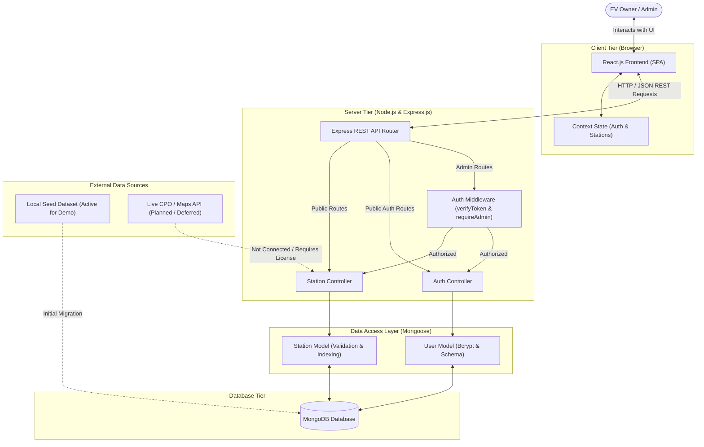
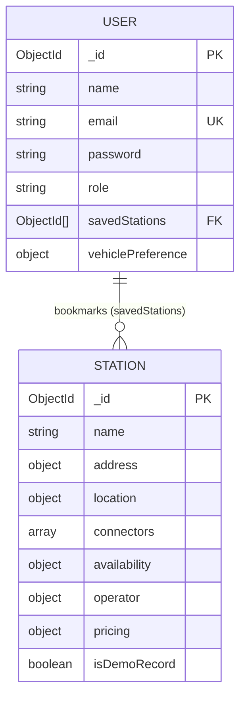

# ChargeNear — System Architecture

## 1. System Overview

ChargeNear is built using the MERN stack (MongoDB, Express.js, React.js, Node.js). The responsibilities of each layer are:

* **React.js (Frontend Presentation Layer):**
  * Executes in the user's browser as a responsive Single Page Application (SPA).
  * Manages UI state, route navigation across the 8 Figma reference screens, and user interactions.
  * Formats and presents charging station details, search queries, filter controls, and recorded availability badges.
  * Communicates asynchronously with the backend REST API via HTTP requests (Fetch or Axios).
* **Node.js (Backend Runtime Layer):**
  * Provides the cross-platform asynchronous JavaScript runtime environment for the server.
  * Executes the API server, manages environment configuration, and handles network I/O.
* **Express.js (Application and Routing Framework):**
  * Organizes API routes, request parsing, and response formatting.
  * Enforces security boundaries and access control via middleware (JWT verification, role authorization, input validation).
  * Serves structured JSON responses conforming to standard HTTP status codes.
* **Mongoose (Object Data Modeling Layer):**
  * Defines structured schemas, type casting, validation rules, and indexes for MongoDB collections.
  * Maps business logic to database queries, providing an abstraction layer over raw MongoDB operations.
* **MongoDB (Data Persistence Layer):**
  * Document-oriented NoSQL database storing persistent records for charging stations and user accounts.
  * Supports geospatial indexing for coordinate lookups and text indexing for search.

---

## 2. Architecture Diagram



> [!NOTE]
> As illustrated, the application currently connects to **MongoDB** using a verified **Local Seed Dataset** for demonstration. Live external CPO telemetry is deferred and not connected.

---

## 3. Project Structure

The project uses a clean, decoupled monorepo structure consistent with `TECHNICAL_SPEC.md`:

```text
chargeNear/
├── backend/
│   ├── src/
│   │   ├── config/
│   │   │   └── db.js                 # MongoDB connection logic & lifecycle handlers
│   │   ├── controllers/
│   │   │   ├── authController.js     # User registration, authentication, token issuance
│   │   │   └── stationController.js  # Station query, filtering, and CRUD operations
│   │   ├── middleware/
│   │   │   ├── auth.js               # JWT verification & admin role check middleware
│   │   │   ├── validate.js           # Request payload & ObjectId validation
│   │   │   └── errorHandler.js       # Global error handling and response formatter
│   │   ├── models/
│   │   │   ├── Station.js            # Mongoose schema for charging stations
│   │   │   └── User.js               # Mongoose schema for accounts & preferences
│   │   ├── routes/
│   │   │   ├── authRoutes.js         # Endpoints: /api/auth/*
│   │   │   └── stationRoutes.js      # Endpoints: /api/stations/*
│   │   ├── utils/
│   │   │   ├── apiResponse.js        # Standard JSON envelope utility
│   │   │   └── seedData.js           # Demo station records & seeding utility
│   │   └── app.js                    # Express app configuration & middleware pipeline
│   ├── server.js                     # HTTP server entry point (listens on PORT)
│   ├── .env.example                  # Environment variable reference template
│   └── package.json
├── frontend/
│   ├── public/
│   │   └── index.html                # HTML entry point with viewport configuration
│   ├── src/
│   │   ├── assets/                   # Station icons, brand marks, and fallback images
│   │   ├── components/
│   │   │   ├── common/               # Button, Input, Modal, Badge, Loader
│   │   │   ├── layout/               # Header, BottomNav, ScreenContainer
│   │   │   └── stations/             # StationCard, StationFilter, StationForm (Admin)
│   │   ├── context/
│   │   │   ├── AuthContext.jsx       # Global user login state and token storage
│   │   │   └── StationContext.jsx    # Global station list, search query, and active filters
│   │   ├── pages/
│   │   │   ├── WelcomePage.jsx       # Screen 1: Welcome & introduction
│   │   │   ├── VehicleSelectPage.jsx # Screen 2: Vehicle model & connector filter setup
│   │   │   ├── LocationPermPage.jsx  # Screen 3: Geolocation permission prompt / manual city
│   │   │   ├── HomePage.jsx          # Screen 4: Main station finder, search & filter view
│   │   │   ├── StationDetailPage.jsx # Screen 5: Detailed station view & connector specs
│   │   │   ├── SavedStationsPage.jsx # Screen 6: Bookmarked stations
│   │   │   ├── ProfilePage.jsx       # Screen 7: User account details & admin toggle
│   │   │   └── OfflineInfoPage.jsx   # Screen 8: Offline guidance & helpline numbers
│   │   ├── services/
│   │   │   └── api.js                # Centralized API service with auth header injection
│   │   ├── styles/
│   │   │   ├── index.css             # Theme variables, typography, reset rules
│   │   │   └── components/           # Component-specific CSS stylesheets
│   │   ├── App.jsx                   # Screen router and view coordinator
│   │   └── main.jsx                  # React DOM mount point
│   ├── .env.example                  # Frontend environment configuration template
│   └── package.json
├── PRD.md                            # Product Requirements Document
├── TECHNICAL_SPEC.md                 # Technical Specification
├── ARCHITECTURE.md                   # System Architecture Specification
└── .gitignore                        # Git exclusion rules for node_modules and .env
```

---

## 4. Request and Data Flow

### 4.1 Station Retrieval and Display Flow
1. **Trigger:** `HomePage` mounts or the user navigates to the station finder.
2. **Frontend Dispatch:** `StationContext` invokes `api.getStations()` (calling `GET /api/stations`).
3. **Backend Routing:** Express directs the request to `stationController.getStations()`.
4. **Data Query:** The controller queries `Station.find()` via Mongoose with optional pagination.
5. **Database Execution:** MongoDB executes the query and returns matching documents.
6. **Response:** Controller wraps results in `{ success: true, count: N, data: [...] }` and returns `200 OK`.
7. **UI Render:** `StationContext` updates its state; `HomePage` maps the records into `StationCard` components displaying station name, address, connectors, and availability status.

### 4.2 Search and Filtering Flow
1. **Trigger:** User types a query (e.g., "Bengaluru") or selects a filter chip (e.g., connector `CCS2` or status `Available`).
2. **Frontend Handling:** `StationContext` constructs query parameters: `GET /api/stations?search=Bengaluru&connector=CCS2&status=Available`.
3. **Backend Parsing:** `stationController` extracts parameters from `req.query`:
   * Text search: builds `$or` regex queries across `name`, `address.city`, and `operator.name` (or uses text indexes).
   * Connector filter: adds `'connectors.type': req.query.connector` to the query object.
   * Status filter: adds `'availability.status': req.query.status` to the query object.
4. **Execution & Return:** Mongoose applies the combined filter object to MongoDB.
5. **UI Update:** If results exist, the station list re-renders with matching cards. If zero results return, the UI presents an empty state message prompting the user to broaden their search criteria.

### 4.3 Station Management (CRUD) Flow
* **Create (`POST /api/stations`):**
  1. Admin submits the station creation form via `StationForm` modal.
  2. Request includes payload and header `Authorization: Bearer <admin_token>`.
  3. `auth.js` middleware validates the JWT and verifies `req.user.role === 'admin'`.
  4. `validate.js` ensures required fields (`name`, `address.city`, `connectors`) are present.
  5. `stationController.createStation` executes `Station.create(req.body)`.
  6. Returns `201 Created` with the created document. Frontend appends the new station to `StationContext`.
* **Update (`PUT /api/stations/:id`):**
  1. Admin edits fields in `StationDetailPage` or management modal.
  2. Middleware verifies token and admin privileges; validates `:id` format.
  3. Controller executes `Station.findByIdAndUpdate(id, req.body, { new: true, runValidators: true })`.
  4. Returns `200 OK` with the updated record. Frontend updates active station state.
* **Delete (`DELETE /api/stations/:id`):**
  1. Admin confirms deletion.
  2. Middleware authorizes request; controller calls `Station.findByIdAndDelete(id)`.
  3. Returns `200 OK`. Frontend removes the station from the local list.

### 4.4 Authentication and Access Control Flow
1. **Login:** User submits credentials to `POST /api/auth/login`.
2. **Validation:** `authController` locates user by email and compares passwords using `bcrypt.compare()`.
3. **Token Generation:** On match, server signs a JWT containing `{ id: user._id, role: user.role }` with a configured expiration.
4. **Token Storage:** Frontend receives token and stores it in `localStorage` / `AuthContext`.
5. **Route Protection:** For admin requests, `api.js` attaches `Authorization: Bearer <token>`.
   * If missing/invalid token: server returns `401 Unauthorized`.
   * If user role is not `admin`: server returns `403 Forbidden`.

### 4.5 Recorded Availability Flow
1. **Data Source:** Station records in MongoDB store an `availability` sub-document containing `status`, `isLiveVerified: false`, `source`, and `lastUpdated`.
2. **Retrieval:** The availability sub-document is returned with standard station queries.
3. **Presentation:**
   * The UI renders a distinct status badge (`Available`, `In Use`, `Offline`, `Unknown`).
   * Displays an honest metadata label: *"Status recorded on [date/time] via [source]"*.
   * Clearly informs the user that status represents database records rather than verified real-time hardware telemetry.

---

## 5. Database Design

### 5.1 Models and Responsibilities

#### Station Model (`Station.js`)
* **Primary Responsibility:** Stores complete charging station metadata, hardware attributes, and availability state.
* **Key Fields:**
  * `name` (String, required): Station brand/site name.
  * `address` (Object, required city): Structured address components (`street`, `city`, `state`, `postalCode`, `landmark`).
  * `location` (GeoJSON Point): `type` ('Point') and `coordinates` (`[longitude, latitude]`). Indexed with `2dsphere`.
  * `connectors` (Array of sub-documents, required): List of supported connectors containing `type` (`CCS2`, `Type 2`, `CHAdeMO`, etc.) and `powerKW`.
  * `availability` (Object): Recorded operational status (`status`, `isLiveVerified`, `source`, `lastUpdated`).
  * `operator` (Object): Operational entity details (`name`, `network`).
  * `pricing` (Object): Billing details (`costPerKWh`, `currency`, `isFree`).
  * `amenities` (Array of Strings): Site conveniences (`Restrooms`, `Cafe`, `WiFi`, etc.).
  * `isDemoRecord` (Boolean, default true): Identifies demonstration records.

#### User Model (`User.js`)
* **Primary Responsibility:** Manages identity, access roles, and user-specific preferences.
* **Key Fields:**
  * `name` (String, required): User display name.
  * `email` (String, required, unique, lowercase): User login identifier.
  * `password` (String, required): Securely hashed password string (hashed via `bcryptjs`).
  * `role` (String, enum: `['user', 'admin']`, default `'user'`): Authorization tier.
  * `savedStations` (Array of ObjectIds, ref: `'Station'`): Bookmarked station references.
  * `vehiclePreference` (Object): Preferred EV make, model, and connector type (`CCS2`, `Type 2`, etc.) used to pre-filter discovery results.

### 5.2 Model Relationships


* **Station to User:** Independent entities. Stations exist globally and can be browsed by all users without requiring user association.
* **User to Station:** A one-to-many reference relationship where `User.savedStations` holds an array of Station ObjectIds. This enables bookmarking without duplicating station data.

---

## 6. Security Boundaries

1. **Public vs. Protected Operations:**
   * **Public:** Station discovery (`GET /api/stations`), station details (`GET /api/stations/:id`), user registration, user login, offline info.
   * **Authenticated User:** Bookmark operations (`POST /api/auth/saved-stations/:id`), viewing own profile (`GET /api/auth/me`).
   * **Administrator Only:** Creating (`POST /api/stations`), updating (`PUT /api/stations/:id`), and deleting (`DELETE /api/stations/:id`) stations.
2. **Authentication Middleware:**
   * Incoming requests to protected routes pass through `verifyToken`.
   * Extracted JWT claims are attached to `req.user`.
   * `requireAdmin` checks `req.user.role === 'admin'`. Unauthenticated or unauthorized requests are rejected prior to reaching controller logic.
3. **Credential Security & Environment Variables:**
   * Database connection strings (`MONGODB_URI`) and JWT secret keys (`JWT_SECRET`) are stored in server-side environment variables loaded via `dotenv`.
   * `.env` files are strictly excluded from version control via `.gitignore`.
   * Templates (`.env.example`) contain only placeholder strings.
   * Frontend applications never receive database connection strings or administrative private keys.
4. **Input Sanitization & Server-side Validation:**
   * MongoDB ObjectId strings are checked using `mongoose.Types.ObjectId.isValid()` before querying.
   * Request bodies for mutations are validated against Mongoose schema rules and enum constraints.
   * Password fields are hashed with a minimum of 10 salt rounds before persistence and stripped from API responses (`select: false` or manual deletion).

---

## 7. Error Handling

| Scenario | Layer Handled | Response / Behavior |
|---|---|---|
| **Database Connection Failure** | Backend (`db.js`) | Logs connection error; Express returns `503 Service Unavailable` with message: `"Database service temporarily unavailable"`. |
| **Invalid Station ID Format** | Backend (`validate.js`) | Checks ObjectId length and format; returns `400 Bad Request` with message: `"Invalid station identifier format"`. |
| **Station Not Found** | Backend (`stationController.js`) | When `findById` returns `null`, returns `404 Not Found` with message: `"Charging station not found"`. |
| **Missing Required Input Fields** | Backend (Mongoose / `validate.js`) | Mongoose validation error trapped; returns `400 Bad Request` with detailed list of invalid or missing fields. |
| **Unauthorized Access Attempt** | Backend (`auth.js`) | Returns `401 Unauthorized` (missing/invalid token) or `403 Forbidden` (non-admin role attempting mutation). |
| **Empty Search / Filter Results** | Frontend (`HomePage.jsx`) | Server returns `200 OK` with `{ count: 0, data: [] }`. Frontend renders a dedicated empty state: *"No charging stations match your criteria"*. |
| **Network or Server Error** | Frontend (`api.js` / Context) | Catches rejected promises; displays a non-blocking toast or banner: *"Unable to load station data. Please check your connection."* |

---

## 8. Implementation Order

To ensure rapid delivery for the hackathon and guarantee core problem statement compliance first, implementation will proceed in the following order:

1. **Step 1: Workspace & Backend Setup**
   * Initialize `backend/` and `frontend/` folders.
   * Set up Express server in `server.js` and connect Mongoose to MongoDB in `config/db.js`.
   * Verify MongoDB connection and environment variable loading.
2. **Step 2: Station Schema & REST CRUD APIs**
   * Implement `Station.js` model with indexes, connector sub-documents, and availability schema.
   * Implement `stationController.js` and `stationRoutes.js` covering `GET`, `POST`, `PUT`, `DELETE`.
   * Create `seedData.js` with realistic demonstration stations and verify API responses using REST client/Postman.
3. **Step 3: React Foundation & Station Listing**
   * Initialize React application in `frontend/`.
   * Establish global CSS variables and styling system in `index.css`.
   * Implement `api.js` service and `StationContext.jsx`.
   * Build `HomePage.jsx` and `StationCard.jsx` to fetch and render stations from `GET /api/stations`.
4. **Step 4: Search, Filtering & Station Details**
   * Implement search input and filter chips (connector type, availability status) in `HomePage.jsx`.
   * Implement `StationDetailPage.jsx` displaying connector breakdowns, pricing, and recorded availability metadata.
   * Implement `VehicleSelectPage.jsx` and `LocationPermPage.jsx` fallback flows.
5. **Step 5: Authentication & Administrative Access Control**
   * Implement `User.js` model, bcrypt hashing, and JWT issuance in `authController.js`.
   * Create `auth.js` middleware enforcing admin permissions on station mutations.
   * Build `AuthContext.jsx`, `ProfilePage.jsx`, and Admin station management modal (`StationForm.jsx`).
6. **Step 6: Polish, Saved Stations, Offline Screen & Demo Setup**
   * Implement `SavedStationsPage.jsx` and `OfflineInfoPage.jsx`.
   * Validate all 12 PRD acceptance criteria.
   * Document clear execution and demonstration instructions in `README.md`.
